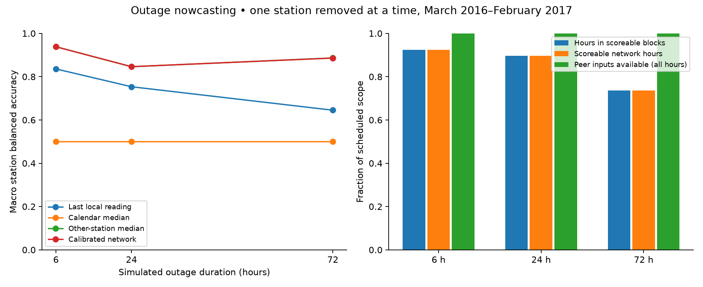

# Can other stations preserve indications during a sensor outage?

This is a **same-hour nowcast under an explicit reporting assumption**. Other
stations must have delivered their readings. It is not a forecast of future
pollution. The tables separate scored performance, truth eligibility, and peer
data availability across the entire schedule. None is observed operational uptime.

| Hours | Method | Balanced accuracy | Stations contributing | MAE (µg/m³) |
| --- | --- | --- | --- | --- |
| 6 | calendar | 0.500 | 12 | 85.3 |
| 6 | network_median | 0.938 | 12 | 13.2 |
| 6 | network_ridge | 0.938 | 12 | 12.8 |
| 6 | persistence | 0.836 | 12 | 24.7 |
| 24 | calendar | 0.500 | 12 | 73.6 |
| 24 | network_median | 0.846 | 12 | 20.4 |
| 24 | network_ridge | 0.846 | 12 | 19.0 |
| 24 | persistence | 0.754 | 12 | 46.8 |
| 72 | calendar | 0.500 | 12 | 85.2 |
| 72 | network_median | 0.887 | 12 | 27.9 |
| 72 | network_ridge | 0.886 | 12 | 25.0 |
| 72 | persistence | 0.645 | 12 | 86.1 |

The high-pollution cutoff is each station's training 90th percentile, with strict
exceedance. It is a research threshold, not a regulatory or health threshold.
Balanced accuracy gives sensitivity and specificity equal weight. A station
without both true classes contributes no balanced accuracy; its counts remain
in [station evidence](station-scores.csv). All methods use the same scoreable
hours in the primary table.

| Hours | Method | Pooled precision | Pooled recall | Pooled false-positive rate |
| --- | --- | --- | --- | --- |
| 6 | calendar | undefined | 0.000 | 0.000 |
| 6 | network_median | 0.821 | 0.911 | 0.044 |
| 6 | network_ridge | 0.831 | 0.911 | 0.041 |
| 6 | persistence | 1.000 | 0.658 | 0.000 |
| 24 | calendar | undefined | 0.000 | 0.000 |
| 24 | network_median | 0.764 | 0.746 | 0.042 |
| 24 | network_ridge | 0.797 | 0.723 | 0.034 |
| 24 | persistence | 0.774 | 0.545 | 0.029 |
| 72 | calendar | undefined | 0.000 | 0.000 |
| 72 | network_median | 0.786 | 0.834 | 0.061 |
| 72 | network_ridge | 0.811 | 0.829 | 0.052 |
| 72 | persistence | 0.691 | 0.337 | 0.041 |

## Coverage changes the scope of the answer

| Hours | Eligible / scheduled blocks | Scoreable network / scheduled hours | Peer data available / scheduled hours |
| --- | --- | --- | --- |
| 6 | 133 / 144 | 798 / 864 | 864 / 864 |
| 24 | 129 / 144 | 3096 / 3456 | 3456 / 3456 |
| 72 | 106 / 144 | 7632 / 10368 | 10368 / 10368 |

The schedule fixes one outage at 09:00 on the first day of each month per station,
at three durations. Each scenario removes only that station. Complete local truth
and a preceding local reading are required to score an outage. Longer eligible
blocks can therefore represent a different cohort, and simulated missingness
need not resemble real failures. Natural missing observations have no known truth.
Network methods abstain when fewer than three other stations report.
Peer-input availability is counted even in blocks excluded for missing local
truth; scoreable network coverage additionally requires that truth. These are
different subsets of the same scheduled hours. Baseline
scores on all their available hours are [retained separately](available-hour-scores.csv).

## Event misses belong beside successful detection delay

| Hours | Method | Missed / high events | False-alert episodes | Median onset delay | Delay sample |
| --- | --- | --- | --- | --- | --- |
| 6 | calendar | 31 / 31 | 0 | None | 0 |
| 6 | network_median | 1 / 31 | 4 | 0.0 | 13 |
| 6 | network_ridge | 3 / 31 | 4 | 0.0 | 11 |
| 6 | persistence | 15 / 31 | 0 | None | 0 |
| 24 | calendar | 67 / 67 | 0 | None | 0 |
| 24 | network_median | 19 / 67 | 12 | 0.0 | 33 |
| 24 | network_ridge | 26 / 67 | 12 | 0.0 | 26 |
| 24 | persistence | 52 / 67 | 0 | 0.0 | 1 |
| 72 | calendar | 187 / 187 | 0 | None | 0 |
| 72 | network_median | 43 / 187 | 23 | 0.0 | 133 |
| 72 | network_ridge | 48 / 187 | 28 | 0.0 | 128 |
| 72 | persistence | 146 / 187 | 0 | 0.0 | 30 |

Delay describes detected, non-left-censored high runs only; missed events remain
in the table. Episodes are defined within blocks, not deduplicated pollution
incidents across stations or overlapping-duration scenarios. One sustained
prediction may overlap multiple high runs. The [event ledger](events.csv.gz)
retains censoring and event times so these denominators can be inspected.

Fit/calibration uses March 2013–February 2015. No local value inside an outage or
future endpoint enters a prediction. No real-gap recovery, future reporting
latency, health benefit, or robustness to correlated network failures is claimed.

[Design](../../../studies/air-quality/DESIGN.md) · [Story](../../../studies/air-quality/STORY.md) ·
[Source audit](../../intake/air-quality.json) · [Schedule](outages.csv) ·
[Predictions](predictions.csv.gz) · [Metrics](metrics.json) · [Run evidence](run.json).
Run `uv run atlas air-quality`. Data: Song Chen (2017), Beijing Multi-Site Air
Quality, UCI, CC BY 4.0; input is the twelve full station files.
