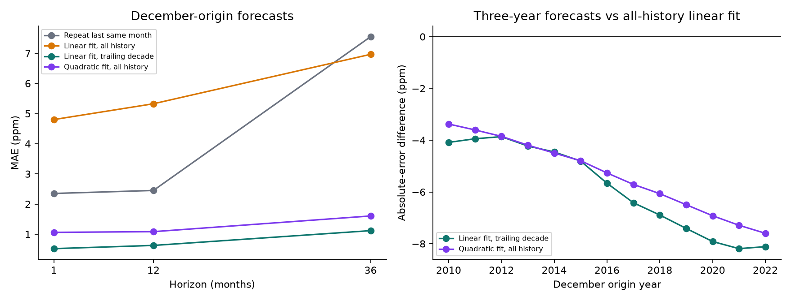
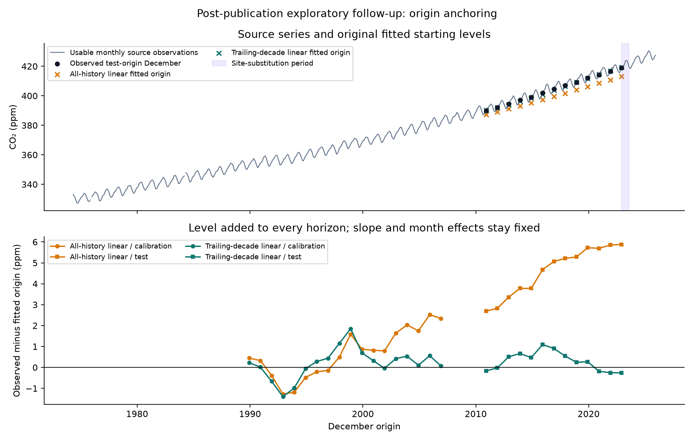

# Does fitting recent history improve multiyear CO₂ forecasts?

The trailing-decade linear fit reduced three-year mean absolute error from 6.964 ppm for the all-history linear fit to 1.119 ppm in this comparison. Both the recent linear and all-history quadratic fits improved on the all-history linear fit at every evaluated three-year origin. **The recent fit improves both its starting level and subsequent growth estimate; this comparison does not isolate growth adaptation alone.**

These are December-origin revised-data hindcasts. The primary comparison predicts December three years later, not an entire monthly trajectory.

| Model | MAE ppm | Bias ppm | 80% coverage | Width ppm | Interval score |
| --- | --- | --- | --- | --- | --- |
| Repeat last same month | 7.548 | -7.548 | 0.0% | 2.828 | 14.493 |
| Linear fit, all history | 6.964 | -6.964 | 0.0% | 4.561 | 41.359 |
| Linear fit, trailing decade | 1.119 | -1.113 | 100.0% | 4.001 | 4.001 |
| Quadratic fit, all history | 1.606 | -1.606 | 100.0% | 4.584 | 4.584 |

There are 13 paired evaluation origins. Negative error differences in the right-hand plot favor the alternative to the all-history linear fit. The full origin-level differences are retained; overlapping three-year errors are not treated as independent samples.

## What the improvement includes

A fresh critique after publication identified an omitted qualification: neither linear regression is anchored to the last observation. Changing the training window changes the fitted level as well as the slope. This **post-publication diagnostic** decomposes the same saved linear predictions, without fitting or selecting another model. Positive values below mean underprediction; all values are means in ppm across the same origins.

| Fit | Observed minus fitted origin | Growth error | Total signed error at three years |
| --- | --- | --- | --- |
| Linear fit, all history | 4.603 | 2.361 | 6.964 |
| Linear fit, trailing decade | 0.294 | 0.819 | 1.113 |

Origin gap plus growth error equals total signed error. This is an arithmetic identity, **not causal attribution or a decomposition of MAE**. The recent fit also estimates the subsequent increase more accurately on average. The original comparison did not evaluate an origin-anchored alternative; the separately dated follow-up below now does. For December predictions p12 and p36, fitted origin = (3 × p12 − p36) / 2; growth error = actual36 − p36 − origin gap. [Per-origin diagnostic](origin-level-diagnostic.csv.gz) · [Fresh critique](../../../reviews/study-critiques-20261030/co2.md).

Intervals use only pre-test calibration outcomes. Their nominal 80% label is a target, not a guarantee. Seasonal naive is a reference; the expanding linear model is the substantive baseline.

Source-quality exclusions, site-substitution target sensitivity, all calibration/test predictions, and metrics are retained. Site sensitivity removes affected **targets**, not all effects of changed-site observations used later in training. No causal explanation or real-time-vintage claim is made.

[Design](../../../studies/co2/DESIGN.md) · [Process story](../../../studies/co2/STORY.md) · [Metrics](metrics.json) · [Run evidence](run.json)

## Post-publication exploratory follow-up: anchor the starting level

**This comparison was declared after the original results were known.** It adds two fixed alternatives; the original predictions and scores remain unchanged. For each linear fit, fitted December = (3 × p12 − p36) / 2. We add observed December minus fitted December to every forecast horizon, preserving the fitted slope and month effects. Only usable observed origins are allowed.

The primary endpoint remains December three years later. The signed change in 36-month MAE (anchored minus original; negative favors anchoring) is All-history linear: -4.603 ppm; Trailing-decade linear: -0.259 ppm. Bias below is prediction minus observation.

| Fit | Months | Targets | MAE ppm | Bias ppm | 80% coverage | Width ppm | Interval score |
| --- | --- | --- | --- | --- | --- | --- | --- |
| All-history linear | 1 | 13 | 4.801 | -4.801 | 0.0% | 2.863 | 29.297 |
| All-history linear | 12 | 13 | 5.325 | -5.325 | 0.0% | 3.592 | 29.870 |
| All-history linear | 36 | 13 | 6.964 | -6.964 | 0.0% | 4.561 | 41.359 |
| Trailing-decade linear | 1 | 13 | 0.522 | -0.291 | 84.6% | 1.515 | 2.315 |
| Trailing-decade linear | 12 | 13 | 0.629 | -0.503 | 84.6% | 2.300 | 2.622 |
| Trailing-decade linear | 36 | 13 | 1.119 | -1.113 | 100.0% | 4.001 | 4.001 |
| All-history linear, anchored | 1 | 13 | 0.351 | -0.199 | 46.2% | 0.463 | 1.976 |
| All-history linear, anchored | 12 | 13 | 0.722 | -0.722 | 84.6% | 1.656 | 1.854 |
| All-history linear, anchored | 36 | 13 | 2.361 | -2.361 | 7.7% | 2.910 | 8.884 |
| Trailing-decade linear, anchored | 1 | 13 | 0.298 | +0.004 | 53.8% | 0.497 | 1.659 |
| Trailing-decade linear, anchored | 12 | 13 | 0.280 | -0.208 | 92.3% | 1.380 | 1.467 |
| Trailing-decade linear, anchored | 36 | 13 | 0.860 | -0.819 | 92.3% | 2.769 | 2.928 |

Each anchored fit/horizon uses its own residual 10th/90th quantiles from the original pre-test calibration period only. The nominal 80% level is not a coverage guarantee. Only observations available by an origin enter that forecast’s adjustment; all interval calibration outcomes precede the first test origin.

Excluding site-substitution-affected **targets** gives this three-year sensitivity; intervals are not recalibrated. All three horizons are in the linked score table.

| Fit | Targets | MAE ppm | Bias ppm | 80% coverage | Width ppm | Interval score |
| --- | --- | --- | --- | --- | --- | --- |
| All-history linear | 12 | 6.926 | -6.926 | 0.0% | 4.561 | 40.980 |
| Trailing-decade linear | 12 | 1.211 | -1.205 | 100.0% | 4.001 | 4.001 |
| All-history linear, anchored | 12 | 2.417 | -2.417 | 0.0% | 2.910 | 9.382 |
| Trailing-decade linear, anchored | 12 | 0.909 | -0.909 | 91.7% | 2.769 | 2.941 |

Target exclusion does not remove substituted-site values from training or from a later origin anchor (including December 2022). This arithmetic intervention is not causal attribution about the atmosphere or a decomposition of MAE. Overlapping multiyear errors are dependent; no superiority test is claimed.

[All calibration/test predictions](followup-predictions.csv.gz) · [Calibration offsets](followup-calibration.csv) · [Origin gaps](followup-origin-gaps.csv.gz) · [All horizons and site sensitivity](followup-scores.csv) · [Metrics](followup-metrics.json) · [Follow-up contract](../../../studies/followups/DESIGN.md).
