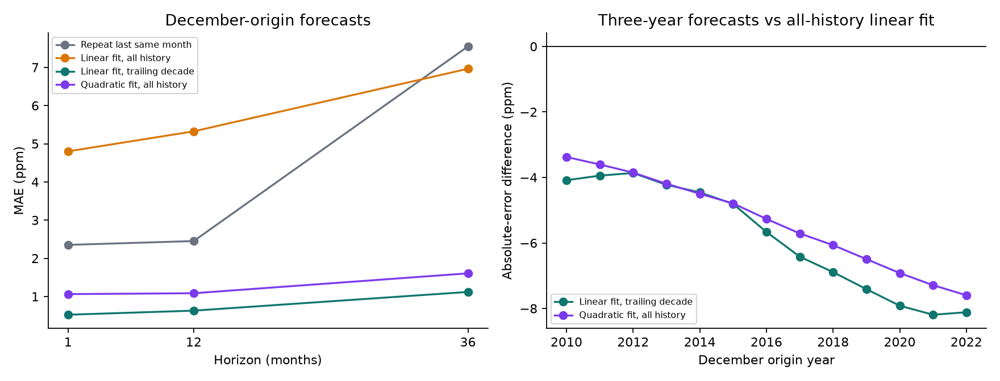

# Does fitting recent history improve multiyear CO₂ forecasts?

The trailing-decade linear fit reduced three-year mean absolute error from 6.964 ppm for the all-history linear fit to 1.119 ppm in this comparison. Both the recent linear and all-history quadratic fits improved on the all-history linear fit at every evaluated three-year origin. **The recent fit improves both its starting level and subsequent growth estimate; this comparison does not isolate growth adaptation alone.**

These are December-origin revised-data hindcasts. The primary comparison predicts December three years later, not an entire monthly trajectory.

| Model | MAE ppm | Bias ppm | 80% coverage | Width ppm | Interval score |
| --- | --- | --- | --- | --- | --- |
| Repeat last same month | 7.548 | -7.548 | 0.0% | 2.828 | 14.493 |
| Linear fit, all history | 6.964 | -6.964 | 0.0% | 4.561 | 41.359 |
| Linear fit, trailing decade | 1.119 | -1.113 | 100.0% | 4.001 | 4.001 |
| Quadratic fit, all history | 1.606 | -1.606 | 100.0% | 4.584 | 4.584 |

There are 13 paired evaluation origins. Negative error differences in the right-hand plot favor the alternative to the all-history linear fit. The full origin-level differences are retained; overlapping three-year errors are not treated as independent samples.

## What the improvement includes

A fresh critique after publication identified an omitted qualification: neither linear regression is anchored to the last observation. Changing the training window changes the fitted level as well as the slope. This **post-publication diagnostic** decomposes the same saved linear predictions, without fitting or selecting another model. Positive values below mean underprediction; all values are means in ppm across the same origins.

| Fit | Observed minus fitted origin | Growth error | Total signed error at three years |
| --- | --- | --- | --- |
| Linear fit, all history | 4.603 | 2.361 | 6.964 |
| Linear fit, trailing decade | 0.294 | 0.819 | 1.113 |

Origin gap plus growth error equals total signed error. This is an arithmetic identity, **not causal attribution or a decomposition of MAE**. The recent fit also estimates the subsequent increase more accurately on average. We have not evaluated an origin-anchored alternative. For December predictions p12 and p36, fitted origin = (3 × p12 − p36) / 2; growth error = actual36 − p36 − origin gap. [Per-origin diagnostic](origin-level-diagnostic.csv.gz) · [Fresh critique](../../../reviews/study-critiques-20261030/co2.md).

Intervals use only pre-test calibration outcomes. Their nominal 80% label is a target, not a guarantee. Seasonal naive is a reference; the expanding linear model is the substantive baseline.

Source-quality exclusions, site-substitution target sensitivity, all calibration/test predictions, and metrics are retained. Site sensitivity removes affected **targets**, not all effects of changed-site observations used later in training. No causal explanation or real-time-vintage claim is made.

[Design](../../../studies/co2/DESIGN.md) · [Process story](../../../studies/co2/STORY.md) · [Metrics](metrics.json) · [Run evidence](run.json)
