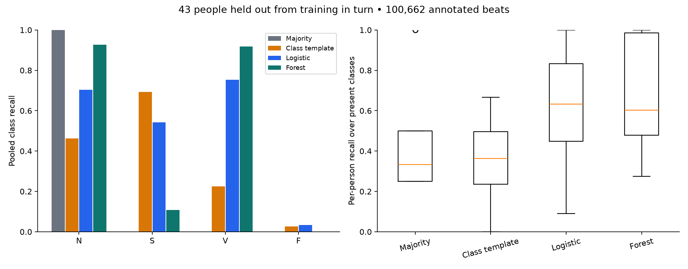
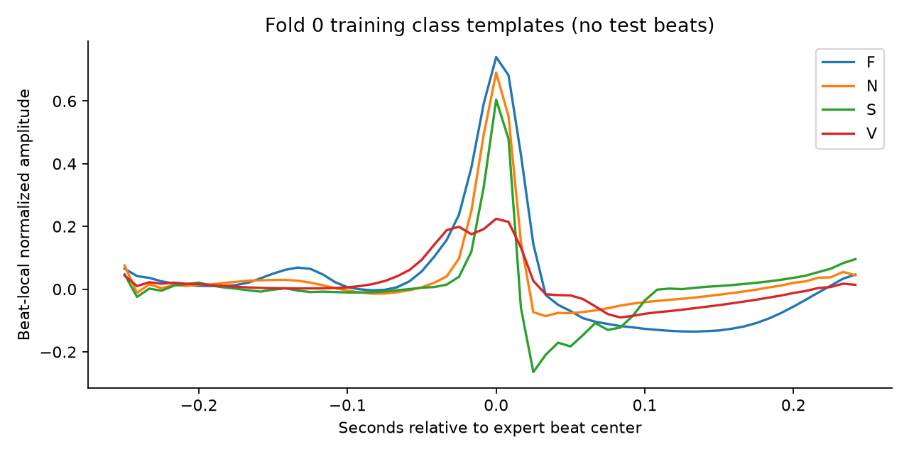
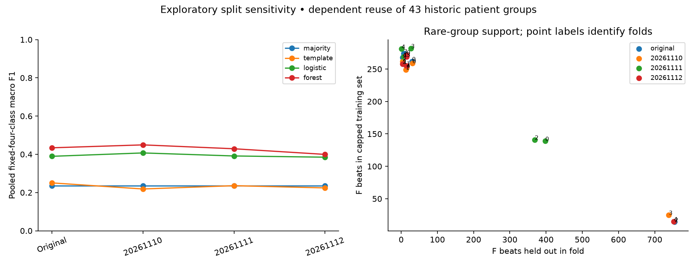

# Do heartbeat patterns transfer to people absent from training?

Under the original frozen fold assignment, transfer was uneven. The forest had the highest four-group macro F1
(0.434, versus 0.236
for always choosing the majority group), but it recognized **none of the 802 F
beats** and only 10.9% of S beats.
Its 89.61% accuracy was barely above the majority
baseline's 89.48%. Overall accuracy concealed major
class failures. That original comparison supports no claim of reliable recognition
across all four groups.

In the original comparison, every retained person is tested once in a fold that excludes that person from
training. The two recordings of patient 201 remain together. Performance by
class and person matters alongside the pooled score; 100,662 beats still provide
only 43 distinct patient groups in this selected historic benchmark.

| Method | Macro F1 (four fixed groups) | Accuracy | Macro class recall |
| --- | --- | --- | --- |
| majority | 0.236 | 0.895 | 0.250 |
| template | 0.250 | 0.448 | 0.351 |
| logistic | 0.390 | 0.697 | 0.509 |
| forest | 0.434 | 0.896 | 0.488 |

| Group | Readable benchmark group | Included symbols | Beats | People with group |
| --- | --- | --- | --- | --- |
| N | Normal, bundle-branch and escape beats | N,L,R,e,j | 90072 | 43 |
| S | Supraventricular ectopic beats | A,a,J,S | 2781 | 31 |
| V | Ventricular ectopic beats | V,E | 7007 | 32 |
| F | Fusion of ventricular and normal beats | F | 802 | 16 |

## What the models were given

This is classification **given expert beat locations**, not an end-to-end beat
detector. Windows use a quarter second before and after that location; previous
RR also uses annotation times. Four paced recordings are excluded and MLII is
selected by name, including its reversed channel position in record 114.
The N benchmark group includes bundle-branch and escape beats: N is not a
healthy-person diagnosis. Other symbols, missing prior RR and waveform boundaries
are counted in the [source audit](../../intake/ecg.json).

The original five folds were fixed before fitting. Training is capped at 1,000 randomly
selected beats per person, without label balancing in that sample selection;
every eligible held-out beat is scored. PCA and fitted feature scaling use only
that fold's training people. Template, logistic and forest are different pipelines,
not a controlled comparison of model families with every other choice identical.
The template baseline compares each normalized waveform with the training class
means; the PCA pipelines also use amplitude and previous beat timing.

Rare examples are concentrated in particular people: fold 2 holds 755 of the
802 F test beats, while its capped training set contains only 14 F examples.
The person split and label-independent cap were frozen before results; we did
not change them to improve this score. This reveals limited rare-class support
under the declared design, not a general impossibility of learning that group.

## How to read the variation

Primary macro F1 averages all four declared classes. Per-person summaries average
only the classes actually present for that person and show their support counts;
they have a different denominator. A rare absent class has undefined recall,
not perfect recognition. Read [person/class support](person-class-scores.csv),
[person scores](person-scores.csv) and [fold scores](fold-scores.csv) beside the plot.
The benchmark deliberately includes unusual rhythms. Scores do not estimate
population prevalence, diagnostic effectiveness or future clinical performance.

The [model audit](model-audit.json) retains training/test people, PCA/scaler/logistic
parameters, templates, forest settings and diagnostics. Forest trees are refitted
by the deterministic reproduction command; their saved hard predictions are
independently scoreable. [Training membership](training-membership.csv.gz) exposes
every capped sample; [test predictions](predictions.csv.gz) expose every outcome.

[Design](../../../studies/ecg/DESIGN.md) · [Story](../../../studies/ecg/STORY.md) ·
[Metrics](metrics.json) · [Run evidence](run.json). Run `uv run atlas ecg`.
Contains information from the MIT-BIH Arrhythmia Database v1.0.0 (Moody and Mark,
2005), DOI10.13026/C2F305, made available under Open Data Commons Attribution1.0.

## Exploratory follow-up: patient composition and split sensitivity

Declared after seeing the original results, these additions preserve the original
comparison. The full precision/recall table makes both missed groups and groups
the model never predicts visible; undefined values are retained.

| Method | Class | True support | Predicted count | Precision | Recall |
| --- | --- | --- | --- | --- | --- |
| majority | N | 90072 | 100662 | 0.895 | 1.000 |
| majority | S | 2781 | 0 | undefined | 0.000 |
| majority | V | 7007 | 0 | undefined | 0.000 |
| majority | F | 802 | 0 | undefined | 0.000 |
| template | N | 90072 | 44618 | 0.932 | 0.462 |
| template | S | 2781 | 27431 | 0.070 | 0.692 |
| template | V | 7007 | 5353 | 0.294 | 0.225 |
| template | F | 802 | 23260 | 0.001 | 0.026 |
| logistic | N | 90072 | 64932 | 0.976 | 0.704 |
| logistic | S | 2781 | 10929 | 0.138 | 0.543 |
| logistic | V | 7007 | 13491 | 0.392 | 0.754 |
| logistic | F | 802 | 11310 | 0.002 | 0.034 |
| forest | N | 90072 | 86181 | 0.969 | 0.927 |
| forest | S | 2781 | 1300 | 0.232 | 0.109 |
| forest | V | 7007 | 13070 | 0.492 | 0.918 |
| forest | F | 802 | 111 | 0.000 | 0.000 |

### Resampling the original saved predictions

The 2,000 patient-cluster bootstrap draws (seed 20261110) each sample all 43
patient groups with replacement, retaining each sampled person's beats together.
The same draw feeds every method. Scores pool the sampled confusion counts and
average F1 across the same four classes, using zero when its denominator is zero.
The forest-minus-logistic contrast is paired within each draw.

| Method or paired contrast | Metric | 2.5th percentile | Median | 97.5th percentile |
| --- | --- | --- | --- | --- |
| majority | accuracy | 0.850 | 0.895 | 0.932 |
| majority | macro_f1 | 0.230 | 0.236 | 0.241 |
| template | accuracy | 0.342 | 0.451 | 0.566 |
| template | macro_f1 | 0.184 | 0.250 | 0.327 |
| logistic | accuracy | 0.607 | 0.698 | 0.789 |
| logistic | macro_f1 | 0.327 | 0.391 | 0.457 |
| forest | accuracy | 0.845 | 0.897 | 0.941 |
| forest | macro_f1 | 0.385 | 0.436 | 0.493 |
| forest-minus-logistic | macro_f1 | -0.027 | 0.046 | 0.115 |

These empirical percentiles describe patient-composition variation conditional
on the fixed saved predictions. They omit training uncertainty and are neither
independent fold replications, population confidence guarantees nor clinical
validation. Audit the [sampled patient indices](followup-bootstrap-draws.csv.gz),
[patient confusion counts](followup-patient-confusions.csv.gz),
[replicate confusion counts](followup-bootstrap-confusions.csv.gz),
[replicate metrics and paired differences](followup-bootstrap-replicates.csv.gz),
and [percentiles](followup-bootstrap-summary.csv.gz).

### Three additional patient assignments

Sorted patient strings are permuted with seeds 20261110, 20261111 and 20261112,
then assigned by permutation position modulo five. Every person is held out once
per completed repeat; both recordings from the shared person remain together.
The original fitting functions, 1,000-beat-per-person training cap and model seeds
remain fixed. Changed membership also changes the capped sampling RNG traversal
and the fold-specific model seed assigned to a person. This is whole-procedure
split sensitivity, not an isolated causal fold effect.

All three additional assignments completed all five folds.

| Assignment | Method | Status | Macro F1 | Accuracy |
| --- | --- | --- | --- | --- |
| original | majority | complete | 0.236 | 0.895 |
| original | template | complete | 0.250 | 0.448 |
| original | logistic | complete | 0.390 | 0.697 |
| original | forest | complete | 0.434 | 0.896 |
| repeat-20261110 | majority | complete | 0.236 | 0.895 |
| repeat-20261110 | template | complete | 0.219 | 0.473 |
| repeat-20261110 | logistic | complete | 0.407 | 0.735 |
| repeat-20261110 | forest | complete | 0.449 | 0.897 |
| repeat-20261111 | majority | complete | 0.236 | 0.895 |
| repeat-20261111 | template | complete | 0.236 | 0.415 |
| repeat-20261111 | logistic | complete | 0.391 | 0.689 |
| repeat-20261111 | forest | complete | 0.429 | 0.870 |
| repeat-20261112 | majority | complete | 0.236 | 0.895 |
| repeat-20261112 | template | complete | 0.224 | 0.407 |
| repeat-20261112 | logistic | complete | 0.385 | 0.699 |
| repeat-20261112 | forest | complete | 0.400 | 0.864 |

The descriptive ranges below include the original and every complete new
assignment. These are dependent reuses of the same historic people, not
independent trials or a p-value for superiority. No repeat is selected as best.

| Method | Metric | Minimum | Maximum | Complete assignments / declared |
| --- | --- | --- | --- | --- |
| majority | macro_f1 | 0.236 | 0.236 | 4 / 4 |
| majority | accuracy | 0.895 | 0.895 | 4 / 4 |
| template | macro_f1 | 0.219 | 0.250 | 4 / 4 |
| template | accuracy | 0.407 | 0.473 | 4 / 4 |
| logistic | macro_f1 | 0.385 | 0.407 | 4 / 4 |
| logistic | accuracy | 0.689 | 0.735 | 4 / 4 |
| forest | macro_f1 | 0.400 | 0.449 | 4 / 4 |
| forest | accuracy | 0.864 | 0.897 | 4 / 4 |

The figure shows the same 43 patient groups under four assignments; its support
panel reports F-class counts after the training cap and before held-out scoring.
See [pooled and fold scores](followup-scores.csv.gz),
[pooled and fold class precision/recall/support](followup-class-scores.csv.gz),
[fold training/test support](followup-fold-support.csv.gz),
[all-assignment comparison](followup-split-comparison.csv.gz) and
[descriptive ranges](followup-split-ranges.csv.gz). Every repeat retains its own
mapping, prediction rows, capped training membership, model audit and metrics:

- Seed 20261110: [mapping](followup-repeat-20261110-mapping.json), [predictions](followup-repeat-20261110-predictions.csv.gz), [training membership](followup-repeat-20261110-training-membership.csv.gz), [model audit](followup-repeat-20261110-model-audit.json), [metrics](followup-repeat-20261110-metrics.json).
- Seed 20261111: [mapping](followup-repeat-20261111-mapping.json), [predictions](followup-repeat-20261111-predictions.csv.gz), [training membership](followup-repeat-20261111-training-membership.csv.gz), [model audit](followup-repeat-20261111-model-audit.json), [metrics](followup-repeat-20261111-metrics.json).
- Seed 20261112: [mapping](followup-repeat-20261112-mapping.json), [predictions](followup-repeat-20261112-predictions.csv.gz), [training membership](followup-repeat-20261112-training-membership.csv.gz), [model audit](followup-repeat-20261112-model-audit.json), [metrics](followup-repeat-20261112-metrics.json).
