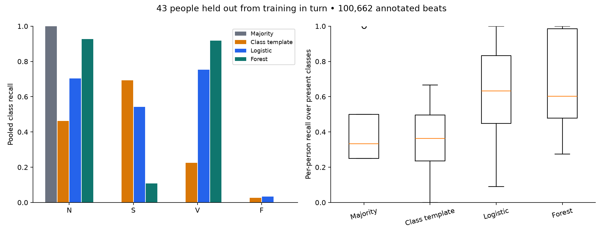
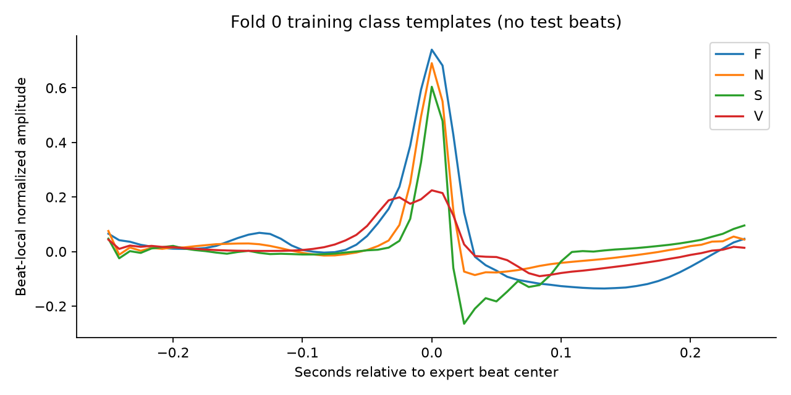

# Do heartbeat patterns transfer to people absent from training?

Transfer was uneven. The forest had the highest four-group macro F1
(0.434, versus 0.236
for always choosing the majority group), but it recognized **none of the 802 F
beats** and only 10.9% of S beats.
Its 89.61% accuracy was barely above the majority
baseline's 89.48%. Overall accuracy concealed major
class failures. No tested pipeline supports a claim of reliable recognition
across all four groups.

Every retained person is tested once in a fold that excludes that person from
training. The two recordings of patient 201 remain together. Performance by
class and person matters alongside the pooled score; 100,662 beats still provide
only 43 distinct patient groups in this selected historic benchmark.

| Method | Macro F1 (four fixed groups) | Accuracy | Macro class recall |
| --- | --- | --- | --- |
| majority | 0.236 | 0.895 | 0.250 |
| template | 0.250 | 0.448 | 0.351 |
| logistic | 0.390 | 0.697 | 0.509 |
| forest | 0.434 | 0.896 | 0.488 |

| Group | Readable benchmark group | Included symbols | Beats | People with group |
| --- | --- | --- | --- | --- |
| N | Normal, bundle-branch and escape beats | N,L,R,e,j | 90072 | 43 |
| S | Supraventricular ectopic beats | A,a,J,S | 2781 | 31 |
| V | Ventricular ectopic beats | V,E | 7007 | 32 |
| F | Fusion of ventricular and normal beats | F | 802 | 16 |

## What the models were given

This is classification **given expert beat locations**, not an end-to-end beat
detector. Windows use a quarter second before and after that location; previous
RR also uses annotation times. Four paced recordings are excluded and MLII is
selected by name, including its reversed channel position in record 114.
The N benchmark group includes bundle-branch and escape beats: N is not a
healthy-person diagnosis. Other symbols, missing prior RR and waveform boundaries
are counted in the [source audit](../../intake/ecg.json).

All five folds were fixed before fitting. Training is capped at 1,000 randomly
selected beats per person, without label balancing in that sample selection;
every eligible held-out beat is scored. PCA and fitted feature scaling use only
that fold's training people. Template, logistic and forest are different pipelines,
not a controlled comparison of model families with every other choice identical.
The template baseline compares each normalized waveform with the training class
means; the PCA pipelines also use amplitude and previous beat timing.

Rare examples are concentrated in particular people: fold 2 holds 755 of the
802 F test beats, while its capped training set contains only 14 F examples.
The person split and label-independent cap were frozen before results; we did
not change them to improve this score. This reveals limited rare-class support
under the declared design, not a general impossibility of learning that group.

## How to read the variation

Primary macro F1 averages all four declared classes. Per-person summaries average
only the classes actually present for that person and show their support counts;
they have a different denominator. A rare absent class has undefined recall,
not perfect recognition. Read [person/class support](person-class-scores.csv),
[person scores](person-scores.csv) and [fold scores](fold-scores.csv) beside the plot.
The benchmark deliberately includes unusual rhythms. Scores do not estimate
population prevalence, diagnostic effectiveness or future clinical performance.

The [model audit](model-audit.json) retains training/test people, PCA/scaler/logistic
parameters, templates, forest settings and diagnostics. Forest trees are refitted
by the deterministic reproduction command; their saved hard predictions are
independently scoreable. [Training membership](training-membership.csv.gz) exposes
every capped sample; [test predictions](predictions.csv.gz) expose every outcome.

[Design](../../../studies/ecg/DESIGN.md) · [Story](../../../studies/ecg/STORY.md) ·
[Metrics](metrics.json) · [Run evidence](run.json). Run `uv run atlas ecg`.
Contains information from the MIT-BIH Arrhythmia Database v1.0.0 (Moody and Mark,
2005), DOI10.13026/C2F305, made available under Open Data Commons Attribution1.0.
