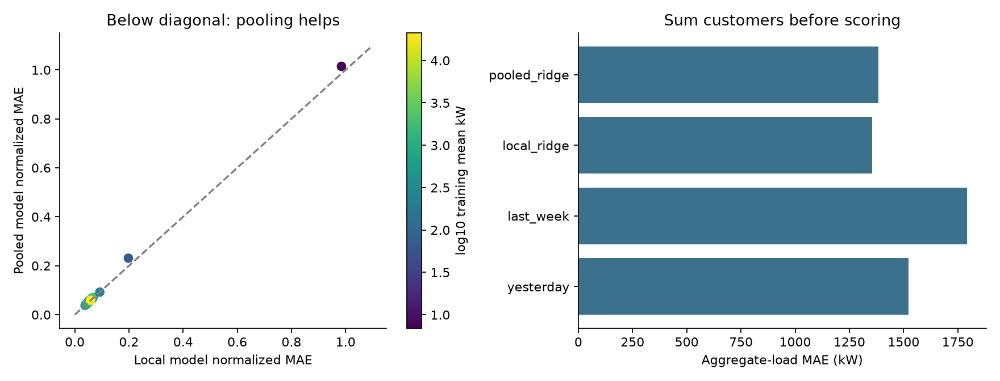

# Does sharing information help tomorrow’s electricity forecasts?

This is a fixed, scale-spanning panel of 24 established customers, not a random sample or new-customer test. Primary results use 2014 dates whose targets and recent history avoid the DST exclusions.

| Model | Macro normalized MAE | Aggregate MAE kW | Aggregate bias kW |
| --- | --- | --- | --- |
| yesterday | 0.1117 | 1522.2 | -7.2 |
| last_week | 0.1283 | 1792.1 | -20.2 |
| local_ridge | 0.0983 | 1355.7 | +10.3 |
| pooled_ridge | 0.1021 | 1384.4 | +20.4 |

Pooling improves normalized MAE for 3 of 24 customers and worsens it for 21. The scatter preserves those differences rather than hiding them in a single average.

Primary evaluation excludes 17280 of 210240 hourly customer observations. Full-date sensitivity and 2013 development scores are retained separately in the metrics file.

Normalized MAE divides each customer’s error by its fixed 2012 mean power; it is not MASE or a percentage-error metric. Peak subsets exceed fixed 2012 thresholds and need not contain 10% of test hours. No intervals, measured cost savings, or production latency claims are made. The nominal-clock interval convention is an assumption, not a UTC reconstruction.

[Design](../../../studies/electricity/DESIGN.md) · [Process story](../../../studies/electricity/STORY.md) · [Metrics](metrics.json) · [Run evidence](run.json)
