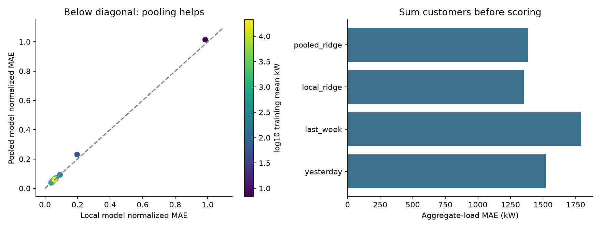

# Does sharing information help tomorrow’s electricity forecasts?

Sharing coefficients did not improve this panel overall: the separate regressions had lower customer-normalized and aggregate-load error. That is a result for this specified comparison, not a claim that all pooled models fail.

This is a fixed, scale-spanning panel of 24 established customers, not a random sample or new-customer test. Primary results use 2014 dates whose targets and recent history avoid the DST exclusions.

| Model | Macro normalized MAE | Aggregate MAE kW | Aggregate bias kW |
| --- | --- | --- | --- |
| Yesterday | 0.1117 | 1522.2 | -7.2 |
| Last week | 0.1283 | 1792.1 | -20.2 |
| Separate regressions | 0.0983 | 1355.7 | +10.3 |
| Shared regression | 0.1021 | 1384.4 | +20.4 |

Pooling improves normalized MAE for 3 of 24 customers and worsens it for 21. The labelled difference plot preserves those magnitudes rather than hiding them in a single average.

Primary evaluation excludes 17280 of 210240 hourly customer observations. Full-date sensitivity and 2013 development scores are retained separately in the metrics file.

The three gains are small; the exact customer-level differences are retained in [the comparison table](customer-comparison.csv.gz). Full-date sensitivity preserves the overall model ranking, but not the identity of every customer with a small gain.

Normalized MAE divides each customer’s error by its fixed 2012 mean power; it is not MASE or a percentage-error metric. Peak subsets exceed fixed 2012 thresholds and need not contain 10% of test hours. No intervals, measured cost savings, or production latency claims are made. The nominal-clock interval convention is an assumption, not a UTC reconstruction.

[Design](../../../studies/electricity/DESIGN.md) · [Process story](../../../studies/electricity/STORY.md) · [Metrics](metrics.json) · [Run evidence](run.json)

## Follow-up: how large is the disadvantage, and who contributes?

Added after publication on 2026-11-10, using the same saved comparisons. Relative
to separate regression, pooled regression changes macro normalized MAE by
**+3.89%** and aggregate MAE by **+2.12%**. These
are relative changes in error, not percentage errors on each observation or
measured business costs. The original count of customers harmed does not show
the magnitude by itself.

The two largest positive customer-normalized error changes,
MT_156, MT_187, account for 68.57% of the **signed net** increase
summed across customers. Gains elsewhere reduce that denominator. Separately,
MT_196 contributes 67.15% of actual load on
the primary test dates. Load share alone does not prove error dominance: the
aggregate score sums signed prediction errors before taking an absolute value.
No customer was removed or reweighted after inspecting these summaries.

[All customer deltas and load shares](followup-customer-context.csv) ·
[Every customer's high-load threshold, count and method scores](followup-peak-scores.md) ·
[Summary values](followup-context.json).
