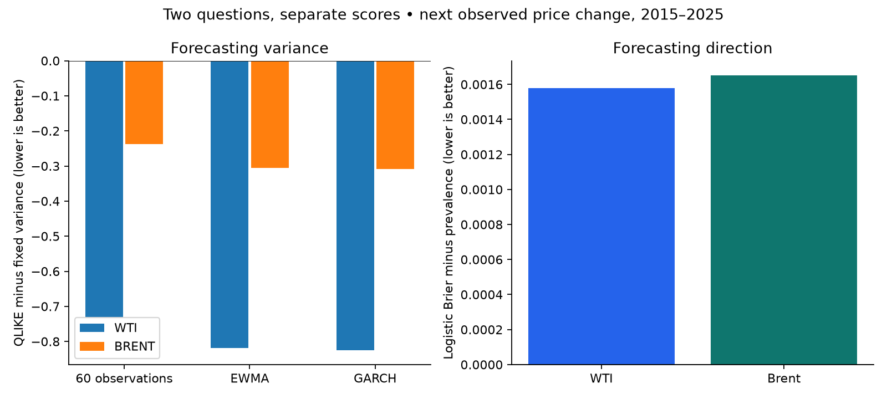

# Can uncertainty be forecast when direction is difficult?

**In this comparison, adaptive variance forecasts improve the declared QLIKE
score for both markets, while logistic direction forecasts perform worse than
the training-prevalence baseline on Brier score.** The fixed variance instead
has the lowest absolute error against squared price changes. A model ranking
depends on the quantity and loss being evaluated; these results do not establish
profitable trading or calibrated financial risk limits.

Brier is the mean squared error of an up/non-up probability. QLIKE scores the variance forecast: it penalizes variance that is too small for large squared changes as well as unnecessarily large forecasts. Smaller is better within each score.

Variance and direction require separate comparisons. Negative values in the
chart mean improvement over that task's simple baseline; the two panels have
different units and must not be compared in magnitude. Every setting was fixed
before evaluating 2015–2025.

| Market | Variance model | QLIKE | Squared-change MAE |
| --- | --- | --- | --- |
| brent | ewma | 1.7101 | 2.828 |
| brent | fixed | 2.0155 | 2.787 |
| brent | garch | 1.7074 | 2.855 |
| brent | rolling_60 | 1.7773 | 2.940 |
| wti | ewma | 1.8586 | 6.182 |
| wti | fixed | 2.6779 | 4.779 |
| wti | garch | 1.8533 | 6.160 |
| wti | rolling_60 | 1.9480 | 6.391 |

| Market | Direction model | Brier | Accuracy |
| --- | --- | --- | --- |
| brent | logistic | 0.2514 | 0.509 |
| brent | prevalence | 0.2498 | 0.515 |
| wti | logistic | 0.2511 | 0.514 |
| wti | prevalence | 0.2495 | 0.521 |

## What was actually forecast

The target is the next **observed** dollar price change for each market, not a
fixed calendar-day return. Weekend and source gaps are not filled with zeros.
The negative WTI observation remains in the experiment; ordinary log returns
would not be defined there. Variance forecasts update from previous changes;
GARCH parameters and the direction model were fitted on 2000–2014 only.

Squared dollar changes are a noisy volatility proxy. QLIKE scores expected
variance differently from absolute proxy error; inspect both. The [annual and
gap breakdown](variance-subgroups.csv) includes a predeclared 2020 stress-period
comparison. The [direction years](direction-years.csv) show how conclusions vary
through time. A lower score does not demonstrate profitable trading, calibrated
tail-risk limits or measured business savings. The [direction gap breakdown](direction-gaps.csv)
also separates short observation gaps from longer ones.
Historical data are revised and
reporting latency is unknown.

GARCH's QLIKE is only slightly lower than the simple EWMA in both markets. That
small difference does not, by itself, justify the additional fitting machinery.
Absolute error against squared changes rewards their conditional median; QLIKE
targets conditional variance under the stated zero-mean change model. Neither
criterion is a universal measure of usefulness.

## Source access is part of reproducibility

EIA identifies Refinitiv as the underlying spot-price source. Free access does
not establish permission to mirror the complete price history. We retain inputs
and true-change evidence locally, publish original forecasts and aggregate scores,
and pin the exact normalized historical-input hash. **This is a source-file
distribution boundary, not a guarantee that derived outcomes are unrecoverable.**
Consecutive published EWMA variance forecasts reveal nearly every test squared
change: `change[t]² = (variance[t+1] − 0.94 × variance[t]) / 0.06`.
GARCH forecasts and their published coefficients similarly expose squared
changes. This does not recover their signs or the complete signed price history.
[The fresh critique](../../../reviews/study-critiques-20261030/oil.md) documents
the reconstruction. Keeping those already-public analytical artifacts is an
explicit publication choice; this disclosure makes no claim of unrestricted
third-party reuse or a demonstrated licence violation.

`uv run atlas fetch oil`
can use a newer workbook only if normalization through 2025 reproduces that hash.
Historical revisions may make exact public reproduction unavailable; the command
fails explicitly rather than silently changing the experiment.

Reproduce locally with `uv run atlas fetch oil` then `uv run atlas oil`.
[Design](../../../studies/oil/DESIGN.md) · [Story](../../../studies/oil/STORY.md) ·
[Audit](../../intake/oil.json) · [Metrics](metrics.json) · [Parameters](parameters.json) ·
[Variance predictions](variance-predictions.csv.gz) · [Direction predictions](direction-predictions.csv.gz) · [Run evidence](run.json).
Source: EIA spot-price workbooks released October 28, 2026, underlying source
Refinitiv; figures, model forecasts and summaries are this project's analysis.

## Follow-up: does the pooled result describe every year?

This descriptive breakdown was added after publication. Every year is shown, including reversals. Smaller QLIKE is better. The last column weights each year’s fixed-minus-EWMA QLIKE difference by its target count, then divides by the signed sum across all years. Negative contributions offset gains; these shares need not lie between zero and one. No year is excluded or selected for fitting.

| Market | Year | Targets | Fixed QLIKE | Rolling QLIKE | EWMA QLIKE | GARCH QLIKE | Share of net EWMA gain |
| --- | --- | --- | --- | --- | --- | --- | --- |
| BRENT | 2015 | 255 | 1.5573 | 1.5539 | 1.5705 | 1.5571 | -0.4% |
| BRENT | 2016 | 255 | 1.3912 | 1.3739 | 1.3916 | 1.3728 | -0.0% |
| BRENT | 2017 | 256 | 1.0693 | 0.7730 | 0.7784 | 0.7683 | 8.7% |
| BRENT | 2018 | 252 | 1.5229 | 1.5106 | 1.4933 | 1.4782 | 0.9% |
| BRENT | 2019 | 257 | 1.5604 | 1.6156 | 1.5544 | 1.5483 | 0.2% |
| BRENT | 2020 | 255 | 2.1056 | 1.9473 | 1.7471 | 1.7784 | 10.7% |
| BRENT | 2021 | 253 | 1.8299 | 2.0393 | 1.8751 | 1.8617 | -1.3% |
| BRENT | 2022 | 252 | 5.7698 | 3.3521 | 3.1512 | 3.1712 | 77.4% |
| BRENT | 2023 | 251 | 2.2305 | 2.1857 | 2.1205 | 2.1193 | 3.2% |
| BRENT | 2024 | 254 | 1.5764 | 1.6368 | 1.5662 | 1.5738 | 0.3% |
| BRENT | 2025 | 253 | 1.5996 | 1.5888 | 1.5888 | 1.5779 | 0.3% |
| WTI | 2015 | 244 | 1.7104 | 1.6893 | 1.6593 | 1.6561 | 0.6% |
| WTI | 2016 | 252 | 1.4782 | 1.3623 | 1.3674 | 1.3580 | 1.2% |
| WTI | 2017 | 250 | 1.1517 | 0.5457 | 0.5669 | 0.5657 | 6.5% |
| WTI | 2018 | 249 | 1.5513 | 1.4862 | 1.4535 | 1.4236 | 1.1% |
| WTI | 2019 | 250 | 1.5145 | 1.4539 | 1.4335 | 1.4175 | 0.9% |
| WTI | 2020 | 252 | 10.2962 | 4.4643 | 3.9193 | 3.9675 | 71.4% |
| WTI | 2021 | 251 | 1.7856 | 1.9198 | 1.8016 | 1.7738 | -0.2% |
| WTI | 2022 | 251 | 4.5895 | 3.2805 | 3.0645 | 3.0687 | 17.0% |
| WTI | 2023 | 248 | 1.9994 | 2.0461 | 2.0055 | 2.0000 | -0.1% |
| WTI | 2024 | 250 | 1.6771 | 1.6492 | 1.6118 | 1.6113 | 0.7% |
| WTI | 2025 | 248 | 1.6062 | 1.4993 | 1.5357 | 1.5190 | 0.8% |

Direction uses its own observed-target counts. Negative logistic-minus-prevalence Brier favors logistic. Winning the full-period average does not mean winning every year; these are descriptive slices, not independent significance tests.

| Market | Year | Targets | Prevalence Brier | Logistic Brier | Difference |
| --- | --- | --- | --- | --- | --- |
| BRENT | 2015 | 255 | 0.2523 | 0.2533 | 0.0010 |
| BRENT | 2016 | 255 | 0.2503 | 0.2496 | -0.0006 |
| BRENT | 2017 | 256 | 0.2493 | 0.2486 | -0.0008 |
| BRENT | 2018 | 252 | 0.2504 | 0.2487 | -0.0018 |
| BRENT | 2019 | 257 | 0.2490 | 0.2520 | 0.0029 |
| BRENT | 2020 | 255 | 0.2494 | 0.2520 | 0.0026 |
| BRENT | 2021 | 253 | 0.2482 | 0.2515 | 0.0033 |
| BRENT | 2022 | 252 | 0.2483 | 0.2569 | 0.0086 |
| BRENT | 2023 | 251 | 0.2495 | 0.2499 | 0.0004 |
| BRENT | 2024 | 254 | 0.2501 | 0.2505 | 0.0004 |
| BRENT | 2025 | 253 | 0.2508 | 0.2529 | 0.0021 |
| WTI | 2015 | 244 | 0.2538 | 0.2537 | -0.0001 |
| WTI | 2016 | 252 | 0.2506 | 0.2528 | 0.0022 |
| WTI | 2017 | 250 | 0.2474 | 0.2462 | -0.0012 |
| WTI | 2018 | 249 | 0.2490 | 0.2483 | -0.0007 |
| WTI | 2019 | 250 | 0.2488 | 0.2476 | -0.0012 |
| WTI | 2020 | 252 | 0.2494 | 0.2618 | 0.0124 |
| WTI | 2021 | 251 | 0.2468 | 0.2465 | -0.0003 |
| WTI | 2022 | 251 | 0.2495 | 0.2529 | 0.0034 |
| WTI | 2023 | 248 | 0.2493 | 0.2511 | 0.0019 |
| WTI | 2024 | 250 | 0.2499 | 0.2514 | 0.0015 |
| WTI | 2025 | 248 | 0.2506 | 0.2501 | -0.0005 |

[Weighted annual contributions](followup-year-contributions.csv) · [Full annual/gap evidence](variance-subgroups.csv) · [Direction years](direction-years.csv).
