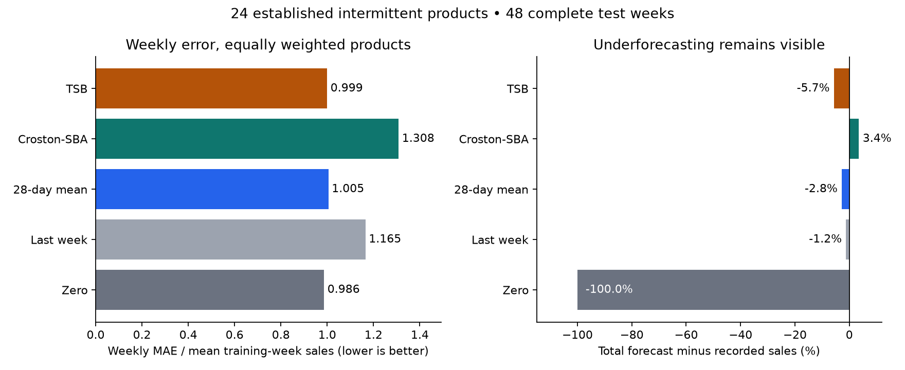
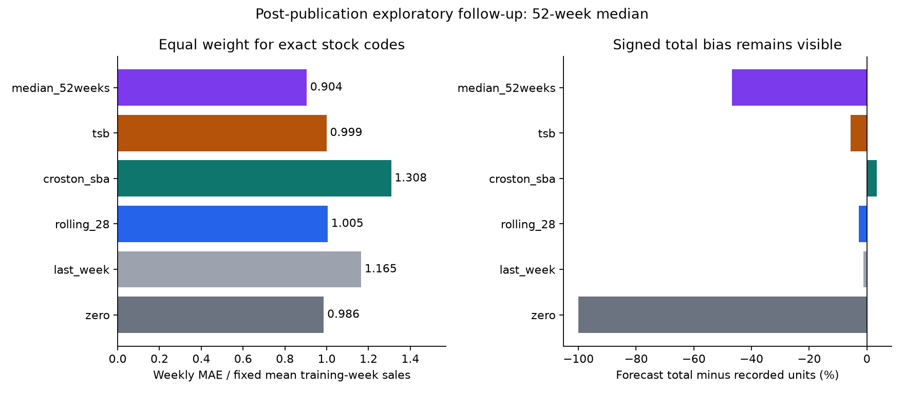

# What should next week's sales forecast optimize?

**2026-11-10 exploratory follow-up:** Among all six methods, median_52weeks has the lowest scaled MAE and median_52weeks has the lowest unit MAE. The historical median scores 0.904 and 23.408, respectively, while forecasting 18,002.5 of 33,858 recorded units. Lower error still does not establish an inventory policy. [See the later comparison and its limits](#post-publication-exploratory-follow-up-a-historical-weekly-median).

In the original five-method comparison on this fixed panel, **zero has the lowest normalized weekly absolute
error (0.986)**. The total-sales comparison below shows
whether a low-error forecast still systematically understates recorded sales.
Neither criterion alone establishes an inventory decision or unmet demand.

Within that original five-method comparison, the ranking changes when errors are counted in raw units: TSB has the lowest
unit MAE (25.92), compared
with zero's 29.39.
The normalized score weights products equally relative to their past sales;
raw-unit error gives large sellers more influence. Neither is a universal winner.

Absolute error rewards a median forecast, while rate-based methods target
average sales. In the test panel, 669
of 1152 product-weeks have zero recorded
sales. That helps explain why a zero forecast can score well. The metric and
the intended decision must be considered together.

| Model | Scaled weekly MAE | Unit MAE | Forecast total | Recorded total |
| --- | --- | --- | --- | --- |
| zero | 0.986 | 29.39 | 0.0 | 33858 |
| last_week | 1.165 | 30.25 | 33435.0 | 33858 |
| rolling_28 | 1.005 | 26.13 | 32904.5 | 33858 |
| croston_sba | 1.308 | 27.26 | 35015.2 | 33858 |
| tsb | 0.999 | 25.92 | 31923.6 | 33858 |

## What this comparison means

The cohort contains 24 exact, case-sensitive stock-code series selected using
2010 sales only, from 2,072 eligible intermittent codes. The retained `product`
column means this source identifier, not a verified harmonized product identity.
We evaluated 48 full weeks in 2011.
Forecasts update using prior transactions only; all smoothing settings were fixed
before test scoring. The mean training-week denominator gives small products a
voice; the second panel instead counts units across products and is dominated by
larger sellers. Those answer different questions. See [per-product](per-product.csv)
and [quarterly](per-quarter.csv) evidence before generalizing a pooled ranking.

`rolling_28` averages the last 28 days. Croston-SBA smooths sale size and the
interval between sales, with a bias adjustment. TSB smooths sale size and the
daily probability of a sale, so its forecast decays during prolonged inactivity.

The workbook repeats 22,523 transaction rows across its annual sheets. Independent
source review verified exact duplicate multiplicities; using the later sheet at
the overlap prevents counting those sales twice. Cancellations, non-merchandise
codes and nonpositive sale rows are excluded under the frozen gross-sales target.
Missing customer IDs remain: product-level sales do not require customer identity.

## Limits and evidence

A recorded zero is not proof of availability or zero demand. This fixed,
nonrandom established-product panel includes later inactivity, and does not
represent new products. There is no stockout, profit or purchasing-cost outcome.
Some differently capitalized source codes have matching descriptions, including
`85232b` and `85232B`. We have no verified identity crosswalk and preserve the
original strings. **Inactivity of a code is not verified product discontinuation**;
splitting a product across aliases could affect its apparent sparsity and history.
[The fresh source check](../../../reviews/study-critiques-20261030/retail.md)
documents examples without asserting that the identifiers should be merged.
Signed bias is a sales-forecast diagnostic. Repeated rows within one annual sheet
remain because their meaning cannot be inferred safely from identical fields.

[Design](../../../studies/retail/DESIGN.md) ·
[Story](../../../studies/retail/STORY.md) · [Source audit](../../intake/retail.json) ·
[Predictions](predictions.csv.gz) · [Metrics](metrics.json) · [Run evidence](run.json).
Reproduce with `uv run atlas retail` from committed source.
Data: Daqing Chen, Online Retail II, UCI (2012), CC BY 4.0;
source and transformations are credited in the repository data documentation.

## Post-publication exploratory follow-up: a historical weekly median

**This comparator and the following diagnostics were declared after the original results were known.** At each existing Monday origin, `median_52weeks` takes the ordinary sample median of 52 complete Monday–Sunday sales totals from exactly the preceding 364 calendar days. Every day must be finite; the current target week is excluded. The exact stock codes, test weeks and fixed 2010 scales are unchanged. There is no tuning. This is a history-conditioned empirical median, not proof of an optimal conditional quantile or order quantity.

Among all six methods, the lowest scaled weekly MAE is attained by median_52weeks; the lowest raw-unit MAE is attained by median_52weeks. These remain descriptive comparisons for the fixed panel.

| Method | Scaled MAE | Unit MAE | Forecast units | Signed total error |
| --- | --- | --- | --- | --- |
| zero | 0.986057 | 29.391 | 0.0 | -33858.0 |
| last_week | 1.164908 | 30.247 | 33435.0 | -423.0 |
| rolling_28 | 1.004962 | 26.134 | 32904.5 | -953.5 |
| croston_sba | 1.308207 | 27.261 | 35015.2 | +1157.2 |
| tsb | 0.999305 | 25.921 | 31923.6 | -1934.4 |
| median_52weeks | 0.904224 | 23.408 | 18002.5 | -15855.5 |

The original five-method scaled-score gap was 0.013248: tsb (0.999305) minus zero (0.986057). Exact code `17003` contributes 21484 of 33858 recorded test units (63.45%). That is a share of recorded volume, not a weight in the equally weighted scaled score. Raw-unit error can be concentrated among large sellers. [Every code’s volume share](followup-volume-shares.csv).

Quarterly minima show the time context; quarter 4 contains only the complete scored weeks through December 4. These dependent subsets do not establish a persistent winner.

| Quarter | Weeks | Original scaled minimum | Original unit minimum | Six-method scaled minimum | Six-method unit minimum |
| --- | --- | --- | --- | --- | --- |
| 2011 Q1 | 13 | zero | zero | median_52weeks | median_52weeks |
| 2011 Q2 | 13 | zero | tsb | median_52weeks | median_52weeks |
| 2011 Q3 | 13 | tsb | rolling_28 | median_52weeks | median_52weeks |
| 2011 Q4 | 9 | rolling_28 | rolling_28 | median_52weeks | median_52weeks |

Every leave-one-code-out exclusion is retained below. The [full score table](followup-leave-one-code-out.csv) reports all six methods for all 24 exclusions, with the original per-code training scales. These overlapping subsets describe sensitivity; no replacement cohort is chosen, and they are not independent replications. Exact ties are listed together.

| Excluded exact code | Scaled-MAE minimum | Unit-MAE minimum |
| --- | --- | --- |
| 16207A | median_52weeks | median_52weeks |
| 17003 | median_52weeks | rolling_28 |
| 21061 | median_52weeks | median_52weeks |
| 21336 | median_52weeks | median_52weeks |
| 21645 | median_52weeks | median_52weeks |
| 21808 | median_52weeks | median_52weeks |
| 22028 | median_52weeks | median_52weeks |
| 22161 | median_52weeks | median_52weeks |
| 22407 | median_52weeks | median_52weeks |
| 22443 | median_52weeks | median_52weeks |
| 37479B | median_52weeks | median_52weeks |
| 46000U | median_52weeks | median_52weeks |
| 72789 | median_52weeks | median_52weeks |
| 84596G | median_52weeks | median_52weeks |
| 84660C | median_52weeks | median_52weeks |
| 84856L | median_52weeks | median_52weeks |
| 84976 | median_52weeks | median_52weeks |
| 85170D | median_52weeks | median_52weeks |
| 85194S | median_52weeks | median_52weeks |
| 85230E | median_52weeks | median_52weeks |
| 85232b | median_52weeks | median_52weeks |
| 90108 | median_52weeks | median_52weeks |
| 90181B | median_52weeks | median_52weeks |
| 90214H | median_52weeks | median_52weeks |

For the last-week forecast, summed prediction minus observation telescopes over contiguous weeks to the pre-test week minus the final target week: 0 − 423 = -423 units. A near-matching total can therefore coexist with large week-by-week allocation errors. The identity is checked separately for every exact code; it is not evidence of an inventory policy’s value.

[All six prediction sets](followup-predictions.csv.gz) · [Metrics](followup-metrics.json) · [Per-code scores](followup-per-product.csv) · [Quarterly scores](followup-per-quarter.csv) · [Boundary-week identity](followup-bias-identity.csv) · [Follow-up contract](../../../studies/followups/DESIGN.md).
