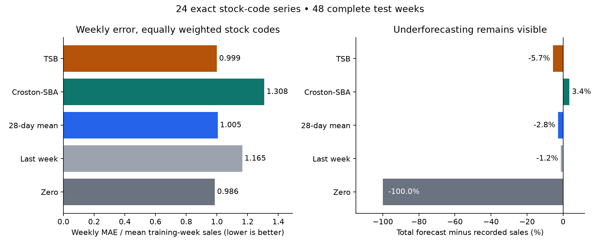

# What should next week's sales forecast optimize?

For this fixed panel, **zero has the lowest normalized weekly absolute
error (0.986)**. The total-sales comparison below shows
whether a low-error forecast still systematically understates recorded sales.
Neither criterion alone establishes an inventory decision or unmet demand.

The ranking changes when errors are counted in raw units: TSB has the lowest
unit MAE (25.92), compared
with zero's 29.39.
The normalized score weights products equally relative to their past sales;
raw-unit error gives large sellers more influence. Neither is a universal winner.

Absolute error rewards a median forecast, while rate-based methods target
average sales. In the test panel, 669
of 1152 product-weeks have zero recorded
sales. That helps explain why a zero forecast can score well. The metric and
the intended decision must be considered together.

| Model | Scaled weekly MAE | Unit MAE | Forecast total | Recorded total |
| --- | --- | --- | --- | --- |
| zero | 0.986 | 29.39 | 0.0 | 33858 |
| last_week | 1.165 | 30.25 | 33435.0 | 33858 |
| rolling_28 | 1.005 | 26.13 | 32904.5 | 33858 |
| croston_sba | 1.308 | 27.26 | 35015.2 | 33858 |
| tsb | 0.999 | 25.92 | 31923.6 | 33858 |

## What this comparison means

The cohort contains 24 exact, case-sensitive stock-code series selected using
2010 sales only, from 2,072 eligible intermittent codes. The retained `product`
column means this source identifier, not a verified harmonized product identity.
We evaluated 48 full weeks in 2011.
Forecasts update using prior transactions only; all smoothing settings were fixed
before test scoring. The mean training-week denominator gives small products a
voice; the second panel instead counts units across products and is dominated by
larger sellers. Those answer different questions. See [per-product](per-product.csv)
and [quarterly](per-quarter.csv) evidence before generalizing a pooled ranking.

`rolling_28` averages the last 28 days. Croston-SBA smooths sale size and the
interval between sales, with a bias adjustment. TSB smooths sale size and the
daily probability of a sale, so its forecast decays during prolonged inactivity.

The workbook repeats 22,523 transaction rows across its annual sheets. Independent
source review verified exact duplicate multiplicities; using the later sheet at
the overlap prevents counting those sales twice. Cancellations, non-merchandise
codes and nonpositive sale rows are excluded under the frozen gross-sales target.
Missing customer IDs remain: product-level sales do not require customer identity.

## Limits and evidence

A recorded zero is not proof of availability or zero demand. This fixed,
nonrandom established-product panel includes later inactivity, and does not
represent new products. There is no stockout, profit or purchasing-cost outcome.
Some differently capitalized source codes have matching descriptions, including
`85232b` and `85232B`. We have no verified identity crosswalk and preserve the
original strings. **Inactivity of a code is not verified product discontinuation**;
splitting a product across aliases could affect its apparent sparsity and history.
[The fresh source check](../../../reviews/study-critiques-20261030/retail.md)
documents examples without asserting that the identifiers should be merged.
Signed bias is a sales-forecast diagnostic. Repeated rows within one annual sheet
remain because their meaning cannot be inferred safely from identical fields.

[Design](../../../studies/retail/DESIGN.md) ·
[Story](../../../studies/retail/STORY.md) · [Source audit](../../intake/retail.json) ·
[Predictions](predictions.csv.gz) · [Metrics](metrics.json) · [Run evidence](run.json).
Reproduce with `uv run atlas retail` from committed source.
Data: Daqing Chen, Online Retail II, UCI (2012), CC BY 4.0;
source and transformations are credited in the repository data documentation.
