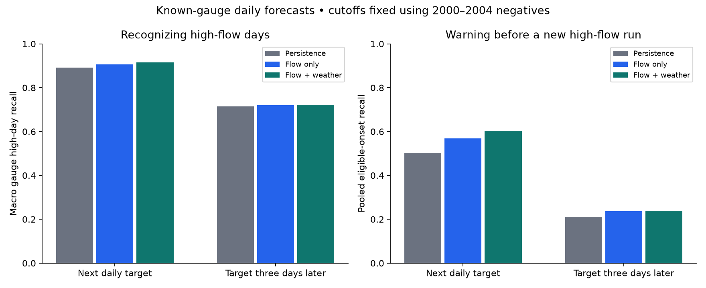

# Does high-flow prediction provide warning before a new rise?

Adding past weather improved next-day high-flow recall only slightly (0.915
versus 0.906 for flow alone). Before new rises, it alerted on 496 of 822 eligible
onsets versus 467 for flow alone, with 830 wholly false alert episodes versus
653. At a three-day date offset, weather added just one detected onset
(166 versus 165 of 696). High-day recall did not translate into equally high eligible-onset recall.

Test false-positive rates were about 14–15%, above the roughly 10% targeted in
calibration. That target did not guarantee the later alert burden. The comparison
below separates high-day recall from new-onset indications and shows their false-alert burden.

| Date offset | Method | Macro recall | Macro false-positive rate | Gauges |
| --- | --- | --- | --- | --- |
| 1 | flow_only | 0.906 | 0.148 | 17 |
| 1 | flow_weather | 0.915 | 0.146 | 17 |
| 1 | persistence | 0.892 | 0.147 | 17 |
| 3 | flow_only | 0.720 | 0.144 | 17 |
| 3 | flow_weather | 0.722 | 0.146 | 17 |
| 3 | persistence | 0.715 | 0.149 | 17 |

| Date offset | Method | Alerted / eligible onsets | Misses | False-alert episodes |
| --- | --- | --- | --- | --- |
| 1 | flow_only | 467 / 822 | 355 | 653 |
| 1 | flow_weather | 496 / 822 | 326 | 830 |
| 1 | persistence | 414 / 822 | 408 | 536 |
| 3 | flow_only | 165 / 696 | 531 | 547 |
| 3 | flow_weather | 166 / 696 | 530 | 697 |
| 3 | persistence | 147 / 696 | 549 | 652 |

## What the warning horizon means

Inputs end on observed day d; we assume those daily aggregates have arrived at
the start of d+1. Targets are daily flow on d+1 or d+3. These are date offsets,
not measured 24- or 72-hour operational lead times. Future rainfall is excluded.
The source weather is retrospective, and its Hr12 field proves no release time.

A high-flow threshold is the training 90th percentile for that gauge. For onset
scoring, the previous day and every day since origin must be observed and non-high.
That condition is a retrospective event-scoring stratum, never an input filter.
The second panel pools eligible events; the first weights gauges equally. A
successful indication of continued high flow does not necessarily warn of onset.
Unknown truth breaks events; censored starts and forecast coverage are retained
in [the event ledger](events.csv.gz).
Alert segments touching unknown truth, absent forecasts or the study boundary
remain unresolved and are counted separately from fully observed false-alert
episodes. False-positive days remain in the primary rates. Primary method
contrasts use matched gauge/horizon sets; any unevaluable model is preserved in
the parameter/status ledger and excluded from that matched comparison explicitly.

## Which rivers and observations this represents

The fixed panel has 17 gauges, chosen by geography and 1980–1999 approved-flow
coverage. No HUC09 candidate met that rule. It is not representative of all
rivers or an ungauged-catchment test. Estimated A:e and missing flow are excluded,
and [split coverage](split-audit.csv) stays visible. [Gauge scores](gauge-scores.csv)
and [area/climate groups](group-scores.csv) expose heterogeneity. Climate groups
use training-period cold precipitation only, not full-record hydrological signatures.
At date offset +3, weather-model recall was 0.858 in the ten higher-cold-fraction
gauges and 0.528 in the seven lower-group gauges; false-positive rates were
0.165 and 0.120. These small, selected groups describe heterogeneity. They do
not establish why catchments differ or a causal effect of cold precipitation.

Training ends in 1999 and calibration in 2004. Source review and a later design
check caught a boundary hazard: early three-day forecasts could otherwise use
calibration outcomes from after their origin. Explicit origin guards remove those
first two boundary targets. All model choices preceded the final 2005–2014 run.
This study establishes no flood damage, hourly warning, or operational benefit.

[Design](../../../studies/river-flow/DESIGN.md) · [Story](../../../studies/river-flow/STORY.md) ·
[Intake audit](../../intake/river-flow.json) · [Predictions](predictions.csv.gz) ·
[Metrics](metrics.json) · [Parameters](parameters.json) · [Run evidence](run.json).
Run `uv run atlas river-flow`. Data: CAMELS-US time series v1.2, observed USGS
streamflow and Daymet basin forcings, DOI10.5065/D6MW2F4D, CC BY 4.0.
