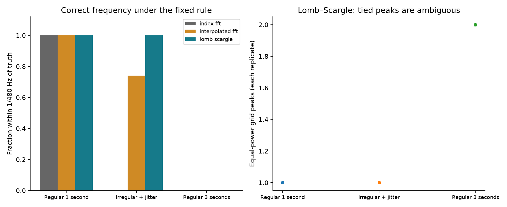
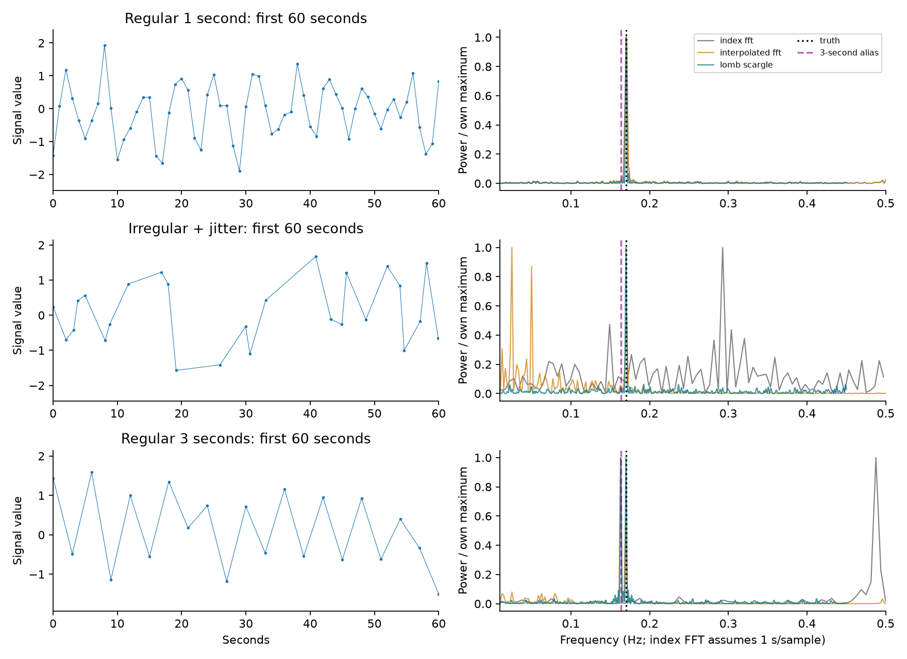

# Can a spectral peak survive the sampling schedule?

With irregular timestamps, Lomb–Scargle recovered the planted frequency in 100 of 100 trials, interpolation plus FFT in 74, and the index FFT in none. With regular three-second sampling, all 100 Lomb–Scargle trials had two equal-power peaks. Its lowest-frequency tie rule selected the alias, so zero counted as recoveries; the data could not uniquely identify the frequency.

The experiment compares an index FFT that assumes one second between samples (correct in the regular control, deliberately wrong for irregular/thinned observations), linear interpolation followed by FFT, and Lomb–Scargle using actual timestamps. Known truth is 0.17 Hz; the same noisy observations feed all methods. This supports the synthetic investigation, not a claim about ECG physiology.

| Sampling | Method | Median absolute error (Hz) | Recovered / 100 | Replicates with tied peaks / 100 |
| --- | --- | --- | --- | --- |
| regular | index_fft | 0.00083 | 100 | 0 |
| regular | interpolated_fft | 0.00083 | 100 | 0 |
| regular | lomb_scargle | 0.00000 | 100 | 0 |
| irregular | index_fft | 0.10674 | 0 | 0 |
| irregular | interpolated_fft | 0.00083 | 74 | 0 |
| irregular | lomb_scargle | 0.00000 | 100 | 0 |
| every_three_seconds | index_fft | 0.31750 | 0 | 0 |
| every_three_seconds | interpolated_fft | 0.00682 | 0 | 0 |
| every_three_seconds | lomb_scargle | 0.00667 | 0 | 100 |

Recovery means within 1/480 Hz of truth. Every-three-second sampling makes 0.17 Hz and 1/3 − 0.17 Hz observationally equivalent. Lomb–Scargle searches the entire alias family of every candidate; equal maxima select the lowest frequency. Even if another tie rule selected the true peak, it would not resolve that ambiguity. Ties refer to numerical grid equality, not a confidence interval. The FFT grids need not contain both equivalent frequencies: zero exact FFT ties do not certify identifiability. Lomb–Scargle’s zero median error is also a discrete-grid result: its grid contains the planted truth, while FFT bins differ. It does not mean noiseless or infinitely precise estimation.

The grid was amended before any recovery results: adding only the true frequency and its alias would not expose aliases of noise-shifted maxima. The expanded grid prevents a numerical search choice from posing as identification.

These are the preselected first replicates, not favorable examples. The left panels show the first 60 seconds; the spectra use the full observation span. Each spectrum is scaled to its own maximum for display; power heights do not compare methods. The [sampling ledger](sampling.csv) retains all sample counts and spans. Noise is drawn at actual observation times; these results depend on the declared single sinusoid, noise, observation window and grid. They establish no universal ranking.

[Design](../../../studies/spectral/DESIGN.md) · [Story](../../../studies/spectral/STORY.md) · [Inputs](inputs.csv.gz) · [Replicate results](replicates.csv.gz) · [Metrics](metrics.json) · [Run evidence](run.json). Run `uv run atlas spectral`.
