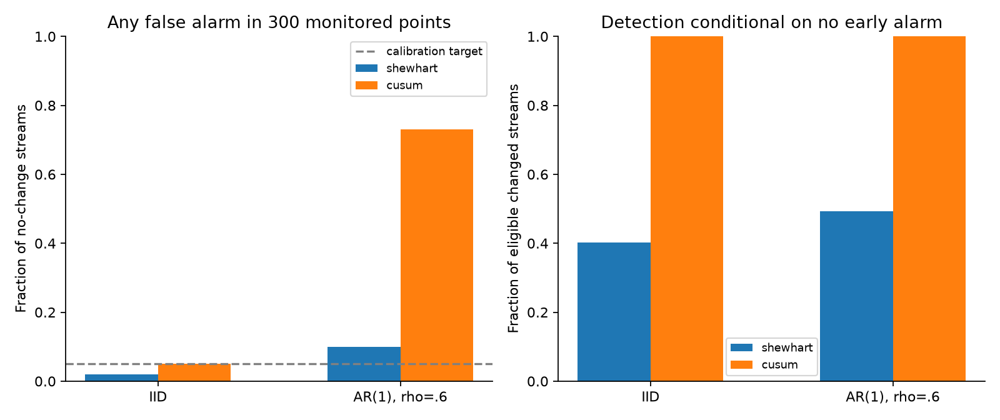

# How quickly can a sustained change be detected?

Thresholds were calibrated on separate IID streams, then frozen. AR(1) streams deliberately violate the independence assumption. These are known-truth simulations, not measured field performance.

| Method | rho | No-change false alerts | Early alarms /200 | Eligible | Detected | Missed | Median detected delay |
| --- | --- | --- | --- | --- | --- | --- | --- |
| shewhart | 0.0 | 2.0% | 4 | 196 | 79 | 117 | 65.0 |
| cusum | 0.0 | 5.0% | 3 | 197 | 197 | 0 | 14.0 |
| shewhart | 0.6 | 10.0% | 3 | 197 | 97 | 100 | 65.0 |
| cusum | 0.6 | 73.0% | 77 | 123 | 123 | 0 | 12.0 |

Each changed condition contains 200 streams. Early alarms remove a stream from the eligible denominator; detected-delay summaries omit misses and must be read beside detection counts. No restart after an early alarm is allowed. Each no-change false-alert rate has denominator 200. A 5% calibration target is not a universal guarantee.

[Design](../../../studies/synthetic/DESIGN.md) · [Process story](../../../studies/synthetic/STORY.md) · [Metrics](metrics.json) · [Run evidence](run.json)
