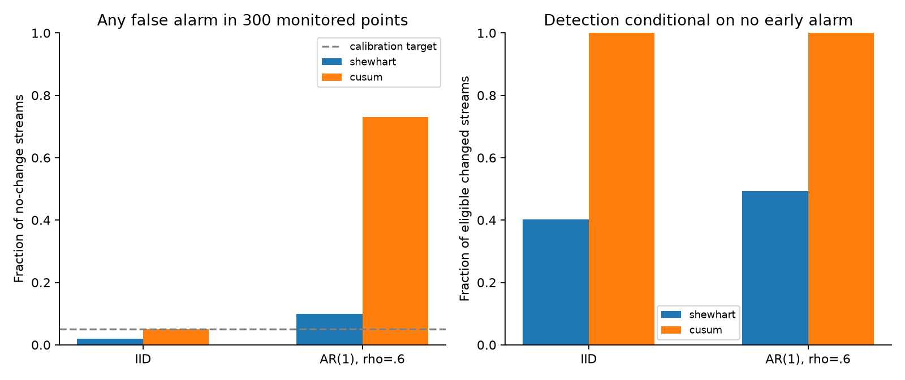
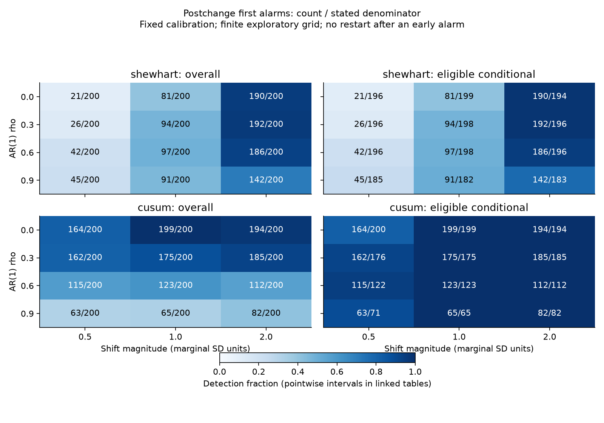

# How quickly can a sustained change be detected?

In the original experiment, CUSUM false-alert frequency rose from 5% on independent noise to 73% on persistent noise under the same frozen threshold. Fast conditional detection did not make it a reliable alarm system in the stress test.

Thresholds were calibrated on separate IID streams, then frozen. AR(1) streams deliberately violate the independence assumption. These are known-truth simulations, not measured field performance.

| Method | rho | No-change false alerts | Early alarms /200 | Eligible | Detected | Missed | Median detected delay (samples) |
| --- | --- | --- | --- | --- | --- | --- | --- |
| shewhart | 0.0 | 2.0% | 4 | 196 | 79 | 117 | 65.0 |
| cusum | 0.0 | 5.0% | 3 | 197 | 197 | 0 | 14.0 |
| shewhart | 0.6 | 10.0% | 3 | 197 | 97 | 100 | 65.0 |
| cusum | 0.6 | 73.0% | 77 | 123 | 123 | 0 | 12.0 |

Each changed condition contains 200 streams. Early alarms remove a stream from the eligible denominator; detected-delay summaries omit misses and must be read beside detection counts. No restart after an early alarm is allowed. Each no-change false-alert rate has denominator 200. A 5% calibration target is not a universal guarantee.

[Design](../../../studies/synthetic/DESIGN.md) · [Process story](../../../studies/synthetic/STORY.md) · [Metrics](metrics.json) · [Run evidence](run.json)

## Exploratory follow-up: dependence and shift grid

This finite comparison was declared after the original results. The original calibration thresholds, standardization, first-alarm rule and no-restart policy remain fixed. Each cell uses 200 independently generated streams; both methods receive the same stream. The grid cannot establish smoothness between tested values.

Zero shift means no change: every alarm is false, including those after index 200. The early count uses indices 100–199 only.

| Method | rho | False alarms / 200 | False-alarm fraction [95% Wilson] | Early / 200 |
| --- | --- | --- | --- | --- |
| shewhart | 0.0 | 9 | 4.5% [2.4%, 8.3%] | 1 |
| cusum | 0.0 | 10 | 5.0% [2.7%, 9.0%] | 2 |
| shewhart | 0.3 | 7 | 3.5% [1.7%, 7.0%] | 3 |
| cusum | 0.3 | 60 | 30.0% [24.1%, 36.7%] | 26 |
| shewhart | 0.6 | 17 | 8.5% [5.4%, 13.2%] | 6 |
| cusum | 0.6 | 151 | 75.5% [69.1%, 80.9%] | 87 |
| shewhart | 0.9 | 38 | 19.0% [14.2%, 25.0%] | 17 |
| cusum | 0.9 | 185 | 92.5% [88.0%, 95.4%] | 132 |

For changed streams, overall detection divides postchange first alarms by 200. Conditional detection divides by the eligible count after removing early alarms. A miss has no alarm by index 399; an early false alarm is a separate outcome. Median delay includes detected streams only, so it is undefined without a detection.

| Method | rho | Shift | Early / 200 | Eligible | Detected / 200 | Overall fraction [95% Wilson] | Conditional fraction [95% Wilson] | No-alarm misses | Median detected delay |
| --- | --- | --- | --- | --- | --- | --- | --- | --- | --- |
| shewhart | 0.0 | 0.5 | 4 | 196 | 21 | 10.5% [7.0%, 15.5%] | 10.7% [7.1%, 15.8%] | 175 | 87.0 |
| cusum | 0.0 | 0.5 | 0 | 200 | 164 | 82.0% [76.1%, 86.7%] | 82.0% [76.1%, 86.7%] | 36 | 47.5 |
| shewhart | 0.0 | 1.0 | 1 | 199 | 81 | 40.5% [33.9%, 47.4%] | 40.7% [34.1%, 47.6%] | 118 | 79.0 |
| cusum | 0.0 | 1.0 | 1 | 199 | 199 | 99.5% [97.2%, 99.9%] | 100.0% [98.1%, 100.0%] | 0 | 14.0 |
| shewhart | 0.0 | 2.0 | 6 | 194 | 190 | 95.0% [91.0%, 97.3%] | 97.9% [94.8%, 99.2%] | 4 | 15.0 |
| cusum | 0.0 | 2.0 | 6 | 194 | 194 | 97.0% [93.6%, 98.6%] | 100.0% [98.1%, 100.0%] | 0 | 4.0 |
| shewhart | 0.3 | 0.5 | 4 | 196 | 26 | 13.0% [9.0%, 18.4%] | 13.3% [9.2%, 18.7%] | 170 | 65.0 |
| cusum | 0.3 | 0.5 | 24 | 176 | 162 | 81.0% [75.0%, 85.8%] | 92.0% [87.1%, 95.2%] | 14 | 41.0 |
| shewhart | 0.3 | 1.0 | 2 | 198 | 94 | 47.0% [40.2%, 53.9%] | 47.5% [40.6%, 54.4%] | 104 | 79.5 |
| cusum | 0.3 | 1.0 | 25 | 175 | 175 | 87.5% [82.2%, 91.4%] | 100.0% [97.9%, 100.0%] | 0 | 13.0 |
| shewhart | 0.3 | 2.0 | 4 | 196 | 192 | 96.0% [92.3%, 98.0%] | 98.0% [94.9%, 99.2%] | 4 | 18.0 |
| cusum | 0.3 | 2.0 | 15 | 185 | 185 | 92.5% [88.0%, 95.4%] | 100.0% [98.0%, 100.0%] | 0 | 4.0 |
| shewhart | 0.6 | 0.5 | 4 | 196 | 42 | 21.0% [15.9%, 27.2%] | 21.4% [16.3%, 27.7%] | 154 | 115.5 |
| cusum | 0.6 | 0.5 | 78 | 122 | 115 | 57.5% [50.6%, 64.1%] | 94.3% [88.6%, 97.2%] | 7 | 32.0 |
| shewhart | 0.6 | 1.0 | 2 | 198 | 97 | 48.5% [41.7%, 55.4%] | 49.0% [42.1%, 55.9%] | 101 | 66.0 |
| cusum | 0.6 | 1.0 | 77 | 123 | 123 | 61.5% [54.6%, 68.0%] | 100.0% [97.0%, 100.0%] | 0 | 11.0 |
| shewhart | 0.6 | 2.0 | 4 | 196 | 186 | 93.0% [88.6%, 95.8%] | 94.9% [90.9%, 97.2%] | 10 | 18.0 |
| cusum | 0.6 | 2.0 | 88 | 112 | 112 | 56.0% [49.1%, 62.7%] | 100.0% [96.7%, 100.0%] | 0 | 5.0 |
| shewhart | 0.9 | 0.5 | 15 | 185 | 45 | 22.5% [17.3%, 28.8%] | 24.3% [18.7%, 31.0%] | 140 | 79.0 |
| cusum | 0.9 | 0.5 | 129 | 71 | 63 | 31.5% [25.5%, 38.2%] | 88.7% [79.3%, 94.2%] | 8 | 24.0 |
| shewhart | 0.9 | 1.0 | 18 | 182 | 91 | 45.5% [38.7%, 52.4%] | 50.0% [42.8%, 57.2%] | 91 | 72.0 |
| cusum | 0.9 | 1.0 | 135 | 65 | 65 | 32.5% [26.4%, 39.3%] | 100.0% [94.4%, 100.0%] | 0 | 25.0 |
| shewhart | 0.9 | 2.0 | 17 | 183 | 142 | 71.0% [64.4%, 76.8%] | 77.6% [71.0%, 83.0%] | 41 | 22.0 |
| cusum | 0.9 | 2.0 | 118 | 82 | 82 | 41.0% [34.4%, 47.9%] | 100.0% [95.5%, 100.0%] | 0 | 4.0 |

The original changed-stream results also have these overall denominators:

| Method | rho | Early / 200 | Eligible | Detected / 200 | Overall fraction [95% Wilson] | Median detected delay |
| --- | --- | --- | --- | --- | --- | --- |
| shewhart | 0.0 | 4 | 196 | 79 | 39.5% [33.0%, 46.4%] | 65.0 |
| cusum | 0.0 | 3 | 197 | 197 | 98.5% [95.7%, 99.5%] | 14.0 |
| shewhart | 0.6 | 3 | 197 | 97 | 48.5% [41.7%, 55.4%] | 65.0 |
| cusum | 0.6 | 77 | 123 | 123 | 61.5% [54.6%, 68.0%] | 12.0 |

Intervals describe pointwise Monte Carlo variation conditional on the frozen calibration, not simultaneous coverage across cells or calibration uncertainty. Method outcomes are paired within streams; marginal Wilson intervals are not paired inference about method differences. The [complete cell table](followup-summary.csv) includes early-alarm and miss proportions, denominators and intervals; [every first alarm](followup-replicates.csv.gz), [original denominator audit](followup-original-summary.csv) and [fixed configuration and metrics](followup-metrics.json) are retained.
